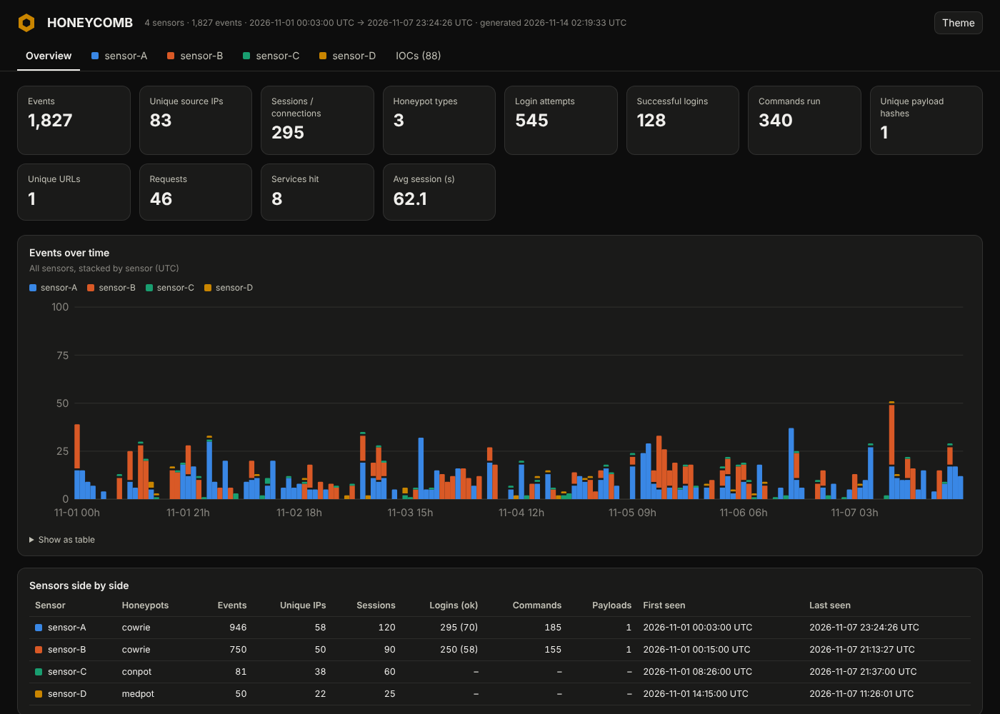
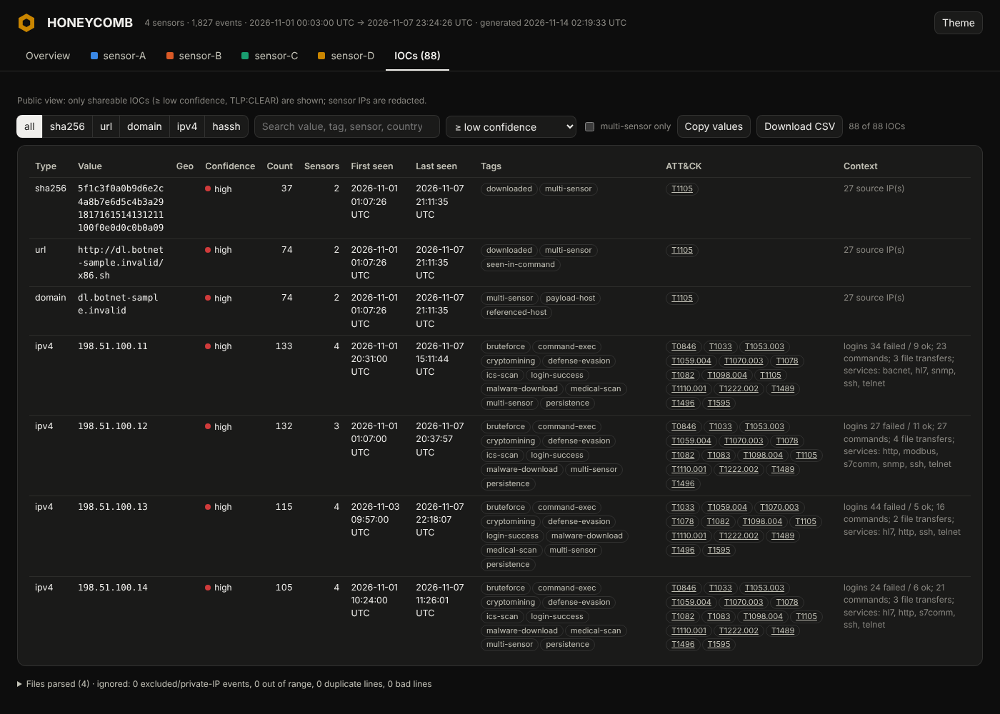

```
    __    __    __
 __/  \__/  \__/  \__    _   _  ___  _   _ _______   ______ ___  __  __ ____
/  \__/  \__/  \__/  \  | | | |/ _ \| \ | | ____\ \ / / ___/ _ \|  \/  | __ )
\__/  \__/  \__/  \__/  | |_| | | | |  \| |  _|  \ V / |  | | | | |\/| |  _ \
/  \__/  \__/  \__/  \  |  _  | |_| | |\  | |___  | || |__| |_| | |  | | |_) |
\__/  \__/  \__/  \__/  |_| |_|\___/|_| \_|_____| |_| \____\___/|_|  |_|____/
   \__/  \__/  \__/

```

**Combs through honeypot logs from many sensors and turns them into an offline dashboard and shareable threat-intel feeds.**

One Python file, standard library only, no network access. Point it at a folder of logs pulled from your honeypots and get:

- a self-contained **HTML dashboard**: an overview, one tab per sensor, a MITRE ATT&CK matrix and a searchable IOC browser
- **IOC feeds**: CSV, JSON, **STIX 2.1** (TAXII-ready, with stable IDs and proper versioning) and plain-text blocklists
- **credential data** (attempted username/password pairs) for wordlist research



## Supported honeypots

Cowrie, Conpot, MedPot, and everything [T-Pot](https://github.com/telekom-security/tpotce) runs:

ADBHoney · Beelzebub · Cisco ASA · Citrix ADC · DDoSPot · Dicompot · Dionaea · Elasticpot · Endlessh · Galah · Glutton · Go-pot · H0neytr4p · Hellpot · Heralding · Honeyaml · Honeytrap · IPPHoney · Log4Pot · Mailoney · Miniprint · qeeqbox honeypots · RDP honeypot · Redis honeypot · SentryPeer · Tanner/Snare · Wordpot

It also reads **T-Pot Elasticsearch exports** (NDJSON from `logstash-*`), and any other JSON log with a source IP and a timestamp is parsed generically. Compressed `.gz` files are fine.

## Quick start

Requires Python 3.8 or newer. Nothing to install.

```bash
git clone https://github.com/really-gabagool/honeycomb
cd honeycomb
python3 honeycomb.py samples --include-private      # try the bundled demo data
```

Open `honeycomb-report/dashboard.html` in a browser.

> The demo data uses only [RFC 5737](https://www.rfc-editor.org/rfc/rfc5737) documentation addresses. HONEYCOMB drops non-public addresses by default, so the demo needs `--include-private`. Don't use that flag on real logs.

## Your own logs

Make one child folder per sensor. Files are found recursively, and the log type is detected per file:

```
honeypot-logs/
├── ssh-us/          cowrie.json, cowrie.json.2026-11-07, ...  (.gz is fine)
├── ics-us/          conpot.json and/or conpot.log
├── med-nyc/         medpot.log
├── tpot-fra1/       a copy of T-Pot's /data folder (cowrie/log, dionaea/log, ...)
├── tpot-export/     NDJSON exported from T-Pot's Elasticsearch
└── sensors.json     optional, see below
```

```bash
python3 honeycomb.py ~/honeypot-logs
python3 honeycomb.py ~/honeypot-logs --days 7 --out ~/reports/week45
python3 honeycomb.py ~/honeypot-logs --public --anonymize-sensors     # dashboard safe to publish
```

On Windows, use `python honeycomb.py C:\honeypot-logs`.

Folder names don't need to say which honeypot is inside. Detection works from the records themselves. The one exception is **DDoSPot**: its records are just a time and an IP, so put it in a folder named `ddospot` (as T-Pot does), or set `"type": "ddospot"` in `sensors.json`.

### sensors.json (optional)

```json
{
  "sensors": {
    "ssh-us":  {"label": "Cowrie US", "public_name": "sensor-us"},
    "ics-us":  {"label": "Conpot ICS", "type": "conpot"},
    "old-box": {"skip": true}
  },
  "exclude":   ["198.51.100.10", "192.0.2.0/24"],
  "allowlist": ["my-monitoring.example"]
}
```

| Key | Meaning |
|---|---|
| `label` | Name shown in your local dashboard |
| `public_name` | Name used in exports (and in `--public` dashboards without `--anonymize-sensors`) |
| `type` | Only read logs of this honeypot type from this folder |
| `skip` | Ignore this folder |
| `exclude` | IPs or CIDRs to ignore, such as your own addresses or your scanners |
| `allowlist` | Domains that are never exported (subdomains match) |
| `scanners` | Extra research-scanner IPs or CIDRs to hold back |

## Outputs

All written to `--out` (default `./honeycomb-report`):

| File | Contents |
|---|---|
| `dashboard.html` | Offline dashboard: no CDN, no external requests, strict Content-Security-Policy |
| `iocs/master_iocs.csv` / `.json` | Every shareable IOC with first/last seen, sensors, tags, confidence, ATT&CK, geo |
| `iocs/stix2_bundle.json` | STIX 2.1 indicators, ATT&CK attack-patterns and `indicates` relationships, with TLP marking |
| `iocs/ipv4.txt`, `ipv6.txt`, `urls.txt`, `domains.txt`, `sha256.txt` | Plain blocklists |
| `iocs/hassh.txt`, `iocs/ssh_keys.txt` | SSH client fingerprints (HASSH) and the public keys attackers tried to log in with (`SHA256:` fingerprints, as `ssh-keygen -l` prints them). Context, not in STIX |
| `credentials.csv` | Attempted logins. Safe to open in a spreadsheet: values starting with `= + - @` get a leading `'` |
| `credentials.jsonl` | The same pairs, byte-for-byte. Use this one for wordlists |



## What stays out of the shareable feeds

- **Your sensors' own IPs**: learned from the logs (Cowrie `dst_ip`, Conpot's external-IP line, ...) plus `--exclude`. This includes IPs inside URLs.
- **Private, reserved and loopback addresses**, and URLs or domains that point at them.
- **Benign services** bots use for connectivity checks (ipinfo.io, ifconfig.me, ...), package mirrors and big platforms, plus anything you add to the allowlist.
- **Shared-hosting domains** (GitHub, Pastebin, S3, Discord CDN, ...). The full payload URL is still exported; the domain isn't, because blocking it would break the internet. Dynamic-DNS hostnames (`evil.duckdns.org`) *are* exported, since each one belongs to a single customer.
- **Research scanners**: recognised two ways. With `--geoip`, by network name (Censys, ONYPHE, Shadowserver's own AS, ...). And by the published ranges in [`scanners.txt`](scanners.txt), which is loaded automatically and catches scanners on cloud space registered under someone else's name (Palo Alto Xpanse on Google, Shadowserver on Hurricane Electric, Shodan on CariNet). Add more lists with `--scanners FILE`; [OpenFilters/internet-scanners](https://github.com/OpenFilters/internet-scanners) publishes a large maintained one in a compatible CIDR format. Keep scanners in the feed with `--keep-research-scanners`.
- **Probably-spoofed sources**: IPs seen only by a UDP reflection honeypot (DDoSPot) are most likely victims, not attackers.

Held-back IOCs still appear in your local dashboard, tagged with the reason.

`--public` makes `dashboard.html` itself safe to publish. It removes local paths, uses export names only, shows only shareable IOCs, and redacts your sensor IPs everywhere. Pair it with `--anonymize-sensors`.

## Confidence levels

| Level | STIX `confidence` | Given when the IP or IOC... |
|---|---|---|
| **high** | 85 | ran commands, downloaded or hosted a payload, attempted an exploit, persisted, mined, or tunnelled through the honeypot |
| | | *(URLs and domains)* given to `wget`/`curl`/`tftp`/`ftpget` in a shell, downloaded by the honeypot, or the download target of an exploit request such as `GET /setup.cgi?cmd=wget+http://…/Mozi.m;sh+…` |
| **medium** | 60 | logged in but did nothing else, brute-forced (≥ `--bruteforce-threshold` failures), scanned ICS/medical protocols, web attacks, or appeared in a payload |
| **low** | 30 | only connected or scanned, however many sensors it hit |

A login alone is **medium** because Cowrie accepts almost any password by design, so "logged in" mostly means a bot tried a common password. What the attacker does *after* the login is what earns **high**. SSH keys attackers try are **low**, and **medium** when sources in different /24 networks use the same key (an operator's key). Research projects that try random keys from one cluster stay low. HASSH fingerprints are always **low**: they identify an SSH client library, which legitimate tools share, so they're research context, not something to block on. They aren't included in the STIX bundle.

On a real honeypot, most IPs only scan. For a public feed, use `--min-confidence medium`: that keeps every IP that did something.

STIX indicators carry `valid_until` = last seen + `--valid-days` (default 30), because honeypot IPs go stale fast.

## GeoIP and ASN (still offline)

Pass a database with `--geoip`, or drop it in `~/.honeycomb/`:

- MaxMind GeoLite2, DB-IP Lite or IPinfo Lite `.mmdb` files (read by a built-in pure-Python reader)
- DB-IP or IP2Location `.csv` / `.csv.gz`

The flag is repeatable, for example City + ASN. T-Pot Elasticsearch exports already carry geo data, which is used when no database is given.

## State between runs

`~/.honeycomb/state.json` remembers every IOC between runs. It's one file for every run, so if your collection script makes a new folder per pull (`1113_2058`, `1113_2155`, ...), each run still continues the same feed:

- `first_seen` stays historic when you use `--days`
- STIX objects keep a fixed `created` and get a new `modified` only when their content changes, as TAXII consumers expect
- `--anonymize-sensors` names stay stable

**The state file contains a secret salt, so don't publish it.** Change its location with `--state FILE`, or disable it with `--no-state`.

## All options

```
python3 honeycomb.py --help
```

| Option | |
|---|---|
| `--out DIR` | Output folder |
| `--since / --until YYYY-MM-DD`, `--days N` | Date window (UTC; `--until` is exclusive) |
| `--exclude IP/CIDR` | Ignore addresses (repeatable, comma-separated) |
| `--allowlist FILE` | More benign domains, one per line |
| `--min-confidence low\|medium\|high` | Floor for the shareable exports |
| `--bruteforce-threshold N` | Failed logins before the `bruteforce` tag (default 5) |
| `--public`, `--anonymize-sensors` | Publishable dashboard and anonymous sensor names |
| `--tlp clear\|green\|amber\|red`, `--org NAME`, `--valid-days N` | STIX settings |
| `--geoip FILE`, `--no-geo` | Geo / ASN |
| `--scanners FILE`, `--no-scanner-list`, `--keep-research-scanners` | Research-scanner ranges (bundled `scanners.txt` plus your own lists), or keep scanners in the feed |
| `--state FILE`, `--no-state` | State file |
| `--dedupe line\|file\|off` | Drop lines repeated across overlapping copies (default), only identical files, or nothing |
| `--conpot-text-too` | Also parse `conpot.log` when `conpot.json` exists (may double count) |
| `--include-private` | Keep non-public source IPs (demo/lab use) |

## Tests

```bash
python3 -m unittest discover -s tests -v
```

Each honeypot type has a one-record fixture in a neutrally named folder, so detection is tested the way real collection scripts name things. End-to-end tests check the outputs, leak filtering, STIX validity and ID stability, public-mode redaction and HTML escaping. The fixtures are synthetic, built from each project's logged field names. If you find a real log HONEYCOMB misreads, please open an issue with a (sanitised) sample line.

## Notes and limitations

- Times without a time zone are taken as UTC. Upstream MedPot logs local time with no zone, so run the droplet on UTC (DigitalOcean's default) or expect an offset.
- `--dedupe line` keeps about 60 bytes of RAM per log line. For very large archives, use `--dedupe file`.
- ATT&CK mapping is heuristic. It's based on command patterns, logins, downloads and protocol, and it's meant as a starting point for analysis, not a verdict.
- HONEYCOMB only reads logs. It never contacts the IPs or URLs it finds.

## License

[MIT](LICENSE)
